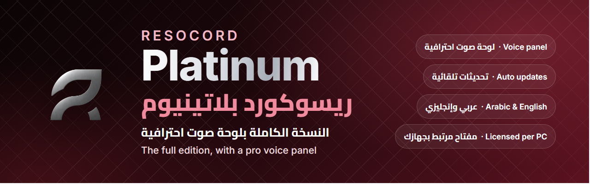
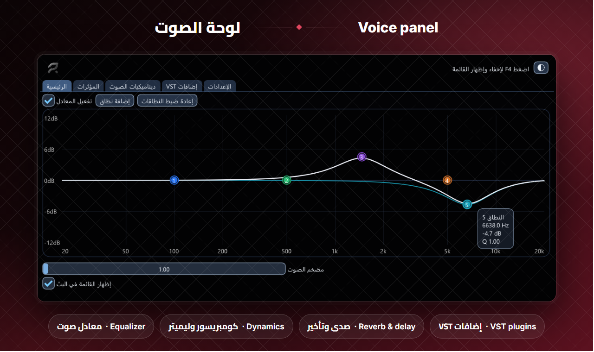
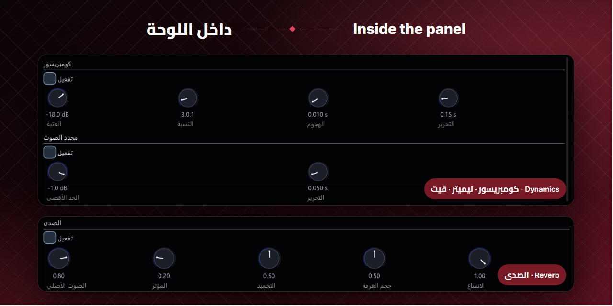
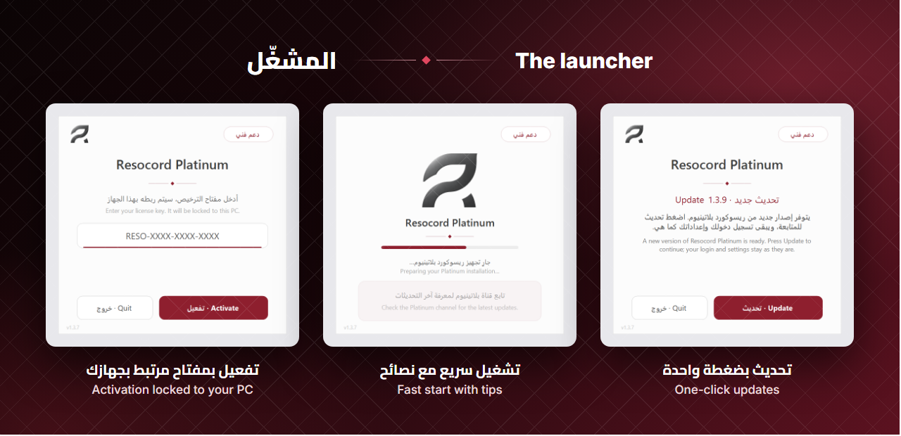

  

  
  
  

<h3 align="center" dir="rtl">النسخة الكاملة من ريسوكورد، بلوحة صوت احترافية وتحديثات تلقائية</h3>

The full edition of Resocord, with a pro voice panel and automatic updates.

 

## ✨ المزايا

| | |
|:--|:--|
| 🎙️ **لوحة صوت احترافية** معادل صوت برسم مباشر يعرض التردد والقوة، كومبريسور وليميتر وقيت، صدى وتأخير وستيريو ودفء الصوت، وإضافات VST. | 🎛️ **إعدادات محفوظة** احفظ إعدادات صوتك وحمّلها بضغطة، واختر اختصار إظهار اللوحة (F4 افتراضيًا). |
| ⚙️ **صفحة Reso Cord** صفحة داخل إعدادات ديسكورد بالعربية والإنجليزية، مع التشغيل مع ويندوز والتشغيل في الخلفية. | 🔄 **تحديثات تلقائية** عند صدور إصدار جديد يحدّث المشغّل نفسه بضغطة واحدة، بتثبيت نظيف في كل مرة. |
| 🔐 **تسجيل دخولك محفوظ** يبقى تسجيل دخولك وإعداداتك بعد كل تحديث، وحتى بعد إغلاق البرنامج بشكل مفاجئ. | 🎮 **نشاط الألعاب** يظهر لأصدقائك ما تلعبه، بما في ذلك أحدث الألعاب. |
| 🌍 **كل مزايا ريسوكورد** واجهة عربية كاملة، بدون إعلانات، وأكثر من 300 إضافة. | 🔑 **مفتاح مرتبط بجهازك** تفعيل بمفتاح ترخيص واحد لجهازك، ودعم فني في سيرفر ريسو. |

 

  

  

  

## ⬇️ التحميل

حمّل أحدث إصدار من [صفحة الإصدارات](https://github.com/resocord/Platinum/releases/latest)، ثم أدخل مفتاح الترخيص عند أول تشغيل. للحصول على مفتاح أو للدعم الفني، انضم إلى [سيرفر ريسو](https://discord.gg/reso).

إذا كان لديك بلاتينيوم 1.3.8 أو أحدث، فلا حاجة للتحميل: المشغّل يعرض **تحديث جديد** عند صدور إصدار جديد.

<b>English</b>

 

**Resocord Platinum** is the full edition of [Resocord](https://github.com/resocord/Resocord), the custom Discord client made for the Arab community.

- 🎙️ **Pro voice panel**: an equalizer with a live graph showing frequency and gain, compressor, limiter, gate, reverb, delay, stereo, warmth and VST plugins.
- 🎛️ **Saved presets**: save and load your sound in one click, and pick the key that shows the panel (F4 by default).
- ⚙️ **Reso Cord page**: inside Discord's settings, in Arabic and English, with Start with Windows and start in the background.
- 🔄 **Automatic updates**: when a new version is out, the launcher updates itself in one click, with a clean install every time.
- 🔐 **Your login stays**: after every update, and even when the app is closed unexpectedly.
- 🎮 **Game activity**: friends see what you're playing, including the newest games.
- 🌍 **Everything in Resocord**: full Arabic interface, no ads, and 300+ plugins.
- 🔑 **Licensed per PC**: one license key, locked to your PC, with support in the Reso server.

**Download** the latest version from the [releases page](https://github.com/resocord/Platinum/releases/latest) and enter your license key on first launch. Get a key or support in the [Reso server](https://discord.gg/reso). On Platinum 1.3.8 or newer there's nothing to download: the launcher shows **Update** when a new version is out.

 

Resocord Platinum is part of <a href="https://github.com/resocord/Resocord">Resocord</a>.

